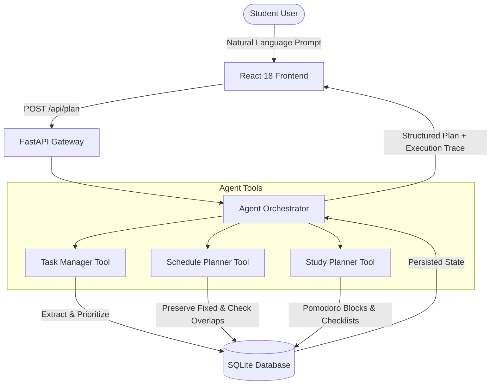

# CampusPilot AI — Project Overview

> An Alexa+-Inspired Student Productivity Agent Built for the Amazon Build, Ship, Shape Hackathon.

---

## 1. The Real-World Problem

University students and self-directed learners face severe cognitive overload. Between lecture commitments, assignment deadlines, exam preparation, and project milestones, students struggle with:
1. **Fragmented Planning:** Calendars, to-do lists, and study timers operate in isolated silos.
2. **Context Fragmentation:** Translating messy syllabus emails, lecture notes, and assignment reminders into an actionable daily schedule requires tedious manual entry.
3. **Silently Compounding Conflicts:** Basic calendars silently allow overlapping tasks or fail to protect study blocks around fixed class hours.
4. **Chatbot Hallucinations:** Generative chatbots produce pleasant conversation but do not maintain real persistent state, do not detect scheduling math conflicts, and cannot directly update a task database.

---

## 2. Why CampusPilot AI Is Useful

CampusPilot AI acts as a personal academic flight controller:
- **Zero-Friction Prompting:** Students describe their day in plain conversational language (`"I have an ML exam tomorrow, a Python assignment due tonight, and classes at 9 AM. Organize my day."`).
- **Deterministic Action:** Rather than hallucinating arbitrary text, the agent invokes dedicated local tools to extract structured tasks, detect scheduling conflicts, and generate tailored Pomodoro study sprints.
- **Relentless Persistence:** Tasks and schedules are stored in an ACID-compliant local SQLite database with stable identifiers, backed by browser localStorage synchronization.
- **Conflict Visibility:** Fixed academic commitments (classes, labs, exams) are locked in place and never silently overwritten. Overlapping commitments are prominently flagged for immediate resolution.

---

## 3. How the Agent Workflow Works

CampusPilot AI uses an **Orchestrated Multi-Tool Pipeline**:

### Execution Steps
1. **Intent Recognition & Extraction:** The Natural Language Extractor parses assignments, exams, and classes without fragile comma-splitting. Deadlines (Tonight, Tomorrow, 18:00) and priorities (High, Normal) are assigned.
2. **Deterministic Scheduling:** The Schedule Planner identifies fixed commitments (e.g. 09:00 class), scans for mutual overlaps, and allocates open daylight windows to flexible tasks ordered by urgency.
3. **Subject-Specific Study Sprints:** The Study Planner analyzes academic subjects and synthesizes 25-minute Pomodoro focus blocks interspersed with 5-minute cognitive breaks.
4. **Database Persistence:** Validated records are written to `campuspilot.db` via Python's built-in `sqlite3` driver.
5. **Transparent Execution Trace:** The UI displays exactly which tools ran, whether they succeeded, and distinguishes real database operations from deterministic simulation logic.

---

## 4. What Makes It Different from a Basic Chatbot?

| Feature | Standard AI Chatbot | CampusPilot AI Agent |
|---|---|---|
| **State Persistence** | Stateless or ephemeral session | Persistent SQLite database + localStorage cache |
| **Tool Calling** | Text generation only | Structured invocation of `extract_tasks`, `make_schedule`, and `study_plan` |
| **Scheduling Math** | Frequent hallucination of overlapping times | Deterministic mathematical conflict checking with interval overlap detection |
| **Task Lifecycle** | Cannot check off or edit items | Full interactive CRUD: add, edit, filter, delete, and toggle tasks |
| **Cost & Offline Reliability** | Requires expensive paid API keys and internet | 100% offline-first, zero external paid dependencies, zero API costs |

---

## 5. Transparent Disclosure: What Is Real vs. Simulated

To preserve complete academic and hackathon integrity:

- **Genuinely Functional:**
  - Real SQLite persistence (`campuspilot.db`) with full CRUD API endpoints.
  - Real deterministic scheduling algorithm with interval conflict detection.
  - Real interactive Pomodoro timer with countdown, pause, reset, and interval progression.
  - Real natural language task extraction and intent classification covering complex multi-part sentences.
  - Real dark and light theme switching with localStorage persistence.
  - 16 passing automated backend unit tests.

- **Simulated Workflow:**
  - **Alexa+ Integration:** Simulated agent workflow inspired by the Alexa+ tool-use vision. Does **not** connect to live Amazon Alexa hardware, Amazon developer accounts, or AWS smart-home endpoints.
  - **External Calendar Sync:** Schedules are managed locally within CampusPilot AI; Google Calendar / Outlook OAuth syncing is simulated through local database slots.

---

## 6. Future Enhancements

1. **Model Context Protocol (MCP) Integration:** Exposing the Task Manager and Schedule Planner as official MCP servers for Claude Desktop and Alexa+ developer tools.
2. **Calendar Protocol (iCal / CalDAV):** Bi-directional sync with Google Calendar, Apple Calendar, and Canvas LMS.
3. **Multi-Day Exam Study Roadmaps:** Spaced repetition schedules spanning 1 to 4 weeks prior to midterm and final exam periods.
