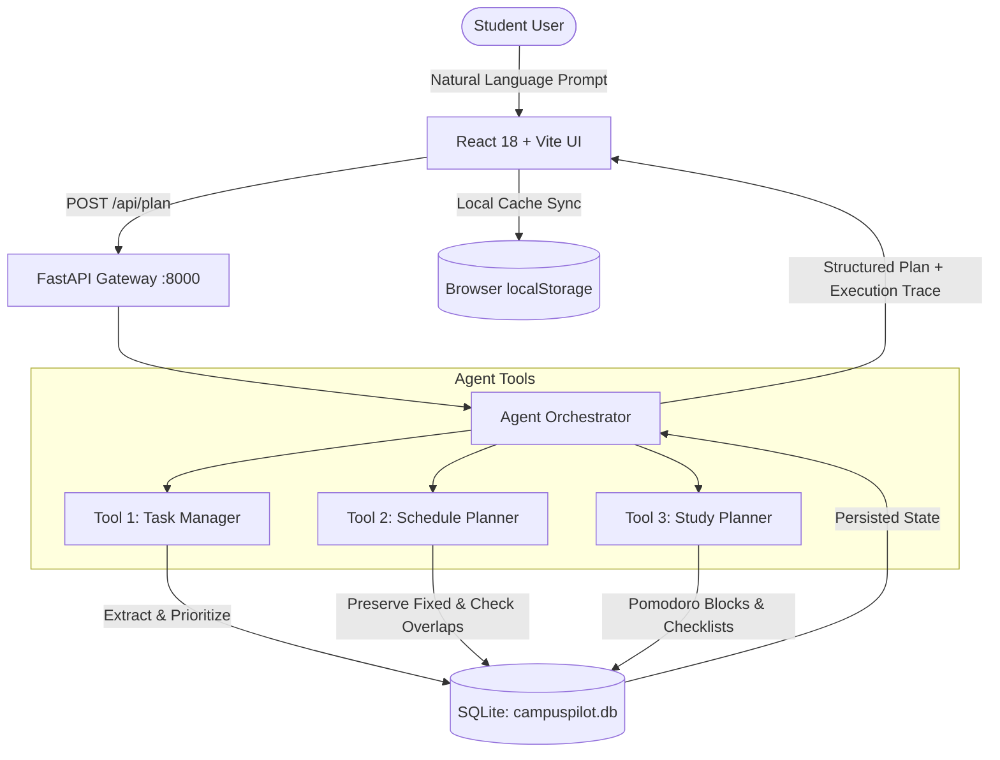

# CampusPilot AI 🎓✈️

> **Alexa+-Inspired Agentic Productivity Assistant for Students**  
> Built for the **Amazon Build, Ship, Shape Developer Hackathon** (Alexa+ Track)

CampusPilot AI translates natural, unstructured student requests into structured tasks, deterministic conflict-free daily schedules, and Pomodoro study routines. It runs **100% locally** with **zero required external paid API keys**, backed by a real SQLite persistence layer and transparent agent tool execution.

---

## 📑 Table of Contents
- [Problem Statement](#-problem-statement)
- [Target Users](#-target-users)
- [Key Features](#-key-features)
- [Architecture](#-architecture)
- [Technology Stack](#-technology-stack)
- [Getting Started on Windows](#-getting-started-on-windows)
- [Example Hackathon Prompts](#-example-hackathon-prompts)
- [API Endpoints](#-api-endpoints)
- [Running Automated Tests](#-running-automated-tests)
- [Screenshots & UI Showcase](#-screenshots--ui-showcase)
- [Scope, Transparency & Limitations](#-scope-transparency--limitations)
- [License](#-license)

---

## 🎯 Problem Statement

University students juggle lectures, labs, problem sets, and exams scattered across syllabus PDFs, emails, and group chats. When asked to plan, generic AI chatbots hallucinate impossible calendar slots, ignore fixed class times, and lack real database persistence.

**CampusPilot AI solves this** by orchestrating three specialized local tools:
1. **Task Manager:** Extracts assignments and deadlines with priority ranking.
2. **Schedule Planner:** Preserves fixed commitments (classes/labs) and arranges flexible study blocks in open windows while actively detecting time conflicts.
3. **Study Planner:** Synthesizes subject-tailored Pomodoro focus and recovery intervals with exam checklists.

---

## 👥 Target Users

- **College & University Students** managing multiple concurrent course syllabi, assignments, and exams.
- **Bootcamp Students & Self-Taught Programmers** balancing coding sprints, lectures, and self-directed revision.
- **Productivity Hackathon Judges & Developers** exploring agent tool calling, deterministic workflows, and personal assistant interfaces inspired by Alexa+.

---

## ✨ Key Features

- **🗣️ Natural Request Understanding:** Understands complete conversational requests (e.g. *"I have an ML exam tomorrow, a Python assignment due tonight, and classes at 9 AM. Organize my day."*) without fragile comma-splitting.
- **🔒 Fixed Event Preservation:** Lectures and meetings locked at specific times (e.g. 9:00 AM) are never silently moved or overwritten.
- **⚠️ Conflict Detection:** Detects overlapping fixed events and tight schedules, highlighting them prominently instead of silently failing.
- **💾 Real SQLite Persistence:** Built-in `sqlite3` data access layer stores tasks, schedules, and study sessions with stable UUIDs.
- **🔄 LocalStorage Resilience:** Dual persistence layer ensures tasks and theme preferences remain saved even when the backend is offline.
- **⏱️ Interactive Pomodoro Timer:** Real countdown timer with focus and break intervals, interval progress, and exam checklists.
- **🎨 Modern Glassmorphism UI:** Complete light and dark themes, responsive desktop sidebar and mobile drawer navigation, accessible keyboard support, and clear feedback states.
- **🔍 Full Task Lifecycle (CRUD):** Add, edit, filter (pending/completed/priority), search, sort by urgency, and delete with safety confirmation.

---

## 🏛️ Architecture



---

## 💻 Technology Stack

| Layer | Technology | Purpose |
|---|---|---|
| **Frontend** | React 18, Vite 5, Vanilla CSS Design System | Interactive dashboard, views, modals, and timer |
| **Backend** | Python 3.10+, FastAPI, Pydantic v2, Uvicorn | Agent orchestrator, validation, and REST API |
| **Persistence** | SQLite (`sqlite3`), LocalStorage | Zero-dependency ACID local database + client cache |
| **Agent Tools** | `extract_tasks`, `make_schedule`, `study_plan` | Deterministic natural language parsing and conflict scheduling |
| **Testing** | Pytest, HTTPX, FastAPI TestClient | 16 automated unit and API integration tests |

---

## 🚀 Getting Started on Windows

### Prerequisites
- [Python 3.10+](https://www.python.org/)
- [Node.js 18+](https://nodejs.org/)

### 1. Start the Backend Server (Terminal 1)
Open PowerShell in the project root directory:

```powershell
cd backend
# Create virtual environment if not already present:
python -m venv .venv

# Activate and install dependencies:
.\.venv\Scripts\Activate.ps1
pip install -r requirements.txt

# Start FastAPI server on port 8000:
uvicorn main:app --reload --port 8000
```
Backend will be live at: **`http://localhost:8000`**  
Interactive API Swagger Docs: **`http://localhost:8000/docs`**

### 2. Start the Frontend Server (Terminal 2)
Open a second PowerShell terminal in the project root:

```powershell
cd frontend
npm install
npm run dev
```
Frontend will be live at: **`http://localhost:5173`** (or `http://localhost:5174`)

---

## 🧪 Example Hackathon Prompts

Try these pre-configured prompts in the **AI Assistant** tab:

1. **Benchmark Prompt:**
   > *"I have an ML exam tomorrow, a Python assignment due tonight, and classes at 9 AM. Organize my day."*
   > - **Result:** Locks classes at `09:00`, prioritizes Python assignment for `Tonight` (High Priority), schedules ML exam preparation for `Tomorrow`, and creates an ML Pomodoro study sprint.

2. **Project & Revision Sprint:**
   > *"I need to submit my project today and revise Python tomorrow."*
   > - **Result:** Extracts project submission (Today, High) and Python revision (Tomorrow).

3. **Fixed Class with Study Sessions:**
   > *"My database class starts at 10 AM. Schedule two study sessions around it."*
   > - **Result:** Locks Database class at `10:00` and creates study slots before and after without overlapping.

4. **Explicit High-Priority Deadline:**
   > *"Add a high-priority task to finish my report by 6 PM."*
   > - **Result:** Creates task with High priority and deadline `18:00`.

5. **Multi-Day Exam Preparation:**
   > *"I have an exam in three days. Help me prepare."*
   > - **Result:** Sets 3-day milestone and generates intensive active-recall checklist.

6. **Agent Actions via Natural Language:**
   > *"Show my pending tasks."*  
   > *"Mark the Python assignment as complete."*

---

## 📡 API Endpoints

| Method | Endpoint | Description |
|---|---|---|
| `POST` | `/api/plan` | Primary Agent endpoint. Interprets request, invokes tools, persists to SQLite, and returns execution trace. |
| `GET` | `/api/tasks` | Lists all tasks ordered by completion and creation date. |
| `POST` | `/api/tasks` | Creates a new task manually in SQLite. |
| `PUT` | `/api/tasks/{task_id}` | Updates task title, priority, deadline, or estimated minutes. |
| `POST` | `/api/tasks/{task_id}/toggle` | Toggles task completion (`done: true/false`). |
| `DELETE` | `/api/tasks/{task_id}` | Permanently deletes a task. |
| `POST` | `/api/tasks/sync` | Batch synchronization endpoint for localStorage data migration. |
| `GET` | `/api/schedule` | Retrieves current day schedule events. |
| `POST` | `/api/schedule` | Saves or updates full schedule timeline. |
| `GET` | `/api/study` | Retrieves active study routine intervals. |
| `GET` | `/api/overview` | Returns aggregate statistics (completion rate, pending count, etc.). |
| `GET` | `/api/health` | Health check endpoint with mode disclosure. |

---

## 🧪 Running Automated Tests

Run the complete 16-test suite from the project root using PowerShell:

```powershell
.\backend\.venv\Scripts\python -m pytest backend/test_backend.py -v
```

### Build Verification
Verify production frontend bundle build:
```powershell
cd frontend
npm run build
```

---

## 📸 Screenshots & UI Showcase

| Dashboard Overview | AI Assistant & Tool Trace |
|:---:|:---:|
| *(Add screenshot: Daily stats, progress bar, urgent deadlines)* | *(Add screenshot: Benchmark prompt, execution steps)* |

| Task Manager (CRUD) | Schedule & Conflict Alert |
|:---:|:---:|
| *(Add screenshot: Search, filters, edit modal)* | *(Add screenshot: Timeline, fixed purple chips, conflict banner)* |

| Study Planner & Pomodoro | Sleek Dark Mode |
|:---:|:---:|
| *(Add screenshot: Countdown timer & exam checklist)* | *(Add screenshot: Dark theme across the workspace)* |

---

## 🛡️ Scope, Transparency & Limitations

- **Simulated Alexa+ Pathway:** CampusPilot AI is inspired by the Alexa+ agentic tool-use model. It is an independent open-source project and does **not** connect to proprietary Amazon cloud accounts, Amazon devices, or live smart home hardware.
- **Zero Paid Dependencies:** Runs 100% locally out-of-the-box using Python's standard `sqlite3` library and deterministic algorithms. No external paid LLM API key is required to start or use the application.
- **Calendar Integrations:** Calendar entries and conflict checks are managed locally within the application; live bi-directional Google/Outlook OAuth calendar sync is not currently connected.
- **Timezone Assumption:** Schedules use local system time.

---

## 📄 License

MIT License. See [LICENSE](LICENSE) for details.
